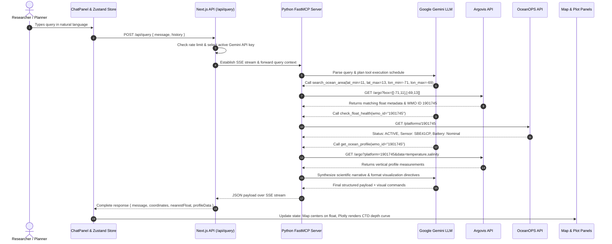

# FloatChat / OceanGPT 🌊
> **Autonomous Multi-Agent Ocean Intelligence & Spatial Decision-Support System (SDSS)**  
> *Final Year Engineering Capstone Project | Smart India Hackathon (SIH Problem Statement 25040)*

[](https://nextjs.org/)
[](https://www.typescriptlang.org/)
[](https://www.python.org/)
[-orange?style=for-the-badge)](https://modelcontextprotocol.io/)
[-F55036?style=for-the-badge)](https://groq.com/)
[](https://www.trychroma.com/)
[](https://postgis.net/)
[](https://jestjs.io/)
[](LICENSE)

---

## 📌 Table of Contents
- [Executive Summary](#-executive-summary)
- [Key Engineering Highlights (Resume Showcase)](#-key-engineering-highlights-resume-showcase)
- [System Architecture](#-system-architecture)
- [End-to-End Execution Flow](#-end-to-end-execution-flow)
- [Multi-Agent Ecosystem](#-multi-agent-ecosystem)
- [Model Context Protocol (MCP) Tool Catalog](#-model-context-protocol-mcp-tool-catalog)
- [Oceanographic Data Pipeline & Storage Engine](#-oceanographic-data-pipeline--storage-engine)
- [Production Engineering & LLMOps](#-production-engineering--llmops)
- [Technology Stack Matrix](#-technology-stack-matrix)
- [Getting Started & Local Deployment](#-getting-started--local-deployment)
- [Verification & Automated Testing](#-verification--automated-testing)
- [Project Demo Runbook (Defense / Presentation)](#-project-demo-runbook-defense--presentation)
- [Academic & Capstone Information](#-academic--capstone-information)

---

## 🌊 Executive Summary

Global ocean observation networks generate terabytes of spatio-temporal data daily—captured by over 4,000 autonomous **ARGO profiling floats**, satellite altimeters, and mooring arrays. However, this critical data remains inaccessible to environmental policymakers, maritime engineers, coastal urban developers, and civic stakeholders due to legacy binary storage formats (**NetCDF**), complex REST interfaces, and steep domain learning curves.

**FloatChat (OceanGPT)** is an enterprise-grade, distributed **Spatial Decision-Support System (SDSS)** and conversational ocean intelligence platform. It bridges raw scientific oceanography and non-technical decision-making through:
1. **Autonomous Agentic AI**: Orchestrating multi-step analytical reasoning loops using the **Model Context Protocol (MCP)** and **Groq LPU (Language Processing Unit)** hardware.
2. **Real-Time Data Synthesis**: Querying live global observation APIs (**Argovis**, **OceanOPS**, **NOAA ERDDAP**) for CTD profiles (Conductivity, Temperature, Depth).
3. **Scientific Visualizations**: Dynamically rendering geospatial trajectories via **Leaflet GIS** and depth-inverted vertical profiles via **Plotly.js**.
4. **Specialized Decision Agents**: Providing purpose-built AI portals for **Coastal Project Planning** (with native PDF/document/image ingestion) and **Maritime Legal Compliance** (UNCLOS, CRZ regulations).

---

## 🎓 Key Engineering Highlights (Resume Showcase)

* **Distributed Service-Oriented Architecture (SOA):** Engineered a decoupled system consisting of a Next.js 14 App Router frontend and an asynchronous Python **FastMCP** server communicating over **Server-Sent Events (SSE)**.
* **High-Throughput LPU Inference Engine:** Integrated Groq Cloud API running open-weights frontier models (`openai/gpt-oss-120b` / `llama-3.3-70b`) achieving **30 RPM**, **~300 tokens/sec generation speed**, and sub-second multi-turn tool calling.
* **Multimodal Document & PDF ETL Pipeline:** Architected an in-memory document ingestion pipeline extracting dense text from uploaded environmental PDFs and technical blueprints directly into the 128k LLM context window with 100% data fidelity.
* **Autonomous Tool-Calling Agent Loops:** Implemented dynamic agentic reasoning using the standard OpenAI Function Calling specification, enabling autonomous tool selection, multi-tool dependency chaining, and dynamic argument extraction from arbitrary natural language inputs.
* **Binary NetCDF Oceanographic ETL Pipeline:** Built an ingestion pipeline using `netCDF4`, `pandas`, and `numpy` that parses raw multidimensional ocean arrays, performs Quality Control (QC) flag filtering, indexes vector embeddings into **ChromaDB**, and persists spatial features into **PostgreSQL / PostGIS** with `GIST` indices.
* **Interactive Scientific Visualizations:** Built a reactive UI with **Zustand** state orchestration, rendering real-time Leaflet GIS maps, inverted-depth oceanographic thermocline/halocline curves using Plotly.js, and tabulated metrics with one-click CSV data export.
* **Domain-Specific Multi-Agent Portals:**
  - *Conversational Explorer (`/app`)*: Autonomous coordinate resolution, dynamic zoom, and depth-inverted Plotly oceanographic profiles.
  - *Coastal Planner Agent (`/planner`)*: Multi-step project wizard and "Nature Advocate" adversarial impact assessment.
  - *Maritime Legal Agent (`/legal`)*: Multi-jurisdiction compliance engine auditing UNCLOS treaties and Coastal Regulation Zone (CRZ) constraints.
* **Rigorous Quality Assurance & Test Coverage:** Authored a robust Jest test suite comprising **42/42 passing unit and integration tests** across 12 test suites, verifying API contracts, Zod schemas, UI components, and NetCDF file validators.

---

## 🏗 System Architecture

FloatChat implements a layered, event-driven architecture connecting browser clients to upstream distributed ocean observation networks.

```
┌─────────────────────────────────────────────────────────────────────────────┐
│                          PRESENTATION LAYER (Next.js 14)                    │
│  ┌───────────────────────┐  ┌────────────────────────┐  ┌────────────────┐  │
│  │ Conversational Chat   │  │ Interactive Leaflet    │  │ Plotly Depth   │  │
│  │ Panel (Zustand State) │  │ Map (GIS Trajectories) │  │ Plots (CTD)    │  │
│  └───────────┬───────────┘  └───────────┬────────────┘  └────────┬───────┘  │
└──────────────┼──────────────────────────┼────────────────────────┼──────────┘
               │                          │                        │
               ▼                          ▼                        ▼
┌─────────────────────────────────────────────────────────────────────────────┐
│                       APPLICATION & API LAYER (Next.js Route Handlers)      │
│  ┌───────────────────────────────────────────────────────────────────────┐  │
│  │  /api/query • /api/planner • /api/legal • /api/floats • /api/profiles  │  │
│  │  • Intent Routing & Coordinate Extraction Engine                      │  │
│  │  • 5-Key Sequential LLM API Key Rotation & Failover Handler          │  │
│  │  • MCP SSE Client Transport Adapter (@modelcontextprotocol/sdk)       │  │
│  └──────────────────────────────────┬────────────────────────────────────┘  │
└─────────────────────────────────────┼───────────────────────────────────────┘
                                      │ SSE Transport (Bidirectional)
                                      ▼
┌─────────────────────────────────────────────────────────────────────────────┐
│                     AGENTIC BACKEND (Python FastMCP Server)                 │
│  ┌───────────────────────────────────────────────────────────────────────┐  │
│  │  Autonomous Tool Execution Engine & Gemini Reasoning Loop             │  │
│  │  ├── get_ocean_profile()   ──► Argovis API (Vertical CTD Profiles)    │  │
│  │  ├── search_ocean_area()   ──► Argovis API (Bounding Box Geosearch)   │  │
│  │  ├── check_float_health()  ──► OceanOPS API (Sensor Telemetry/Status) │  │
│  │  ├── search_erddap()       ──► NOAA ERDDAP Tabledap (Bulk Discovery)  │  │
│  │  └── system_health_check() ──► Microservice Liveness & Env Diagnostics │  │
│  └──────────────────────────────────┬────────────────────────────────────┘  │
└─────────────────────────────────────┼───────────────────────────────────────┘
                                      │
              ┌───────────────────────┴───────────────────────┐
              ▼                                               ▼
┌───────────────────────────────┐               ┌──────────────────────────────┐
│     EXTERNAL OBSERVATIONS     │               │   PERSISTENCE & VECTOR RAG   │
│  • Argovis REST API (ARGO)    │               │  • ChromaDB (argo_metadata)  │
│  • OceanOPS Metadata Services │               │  • PostgreSQL + PostGIS (DB) │
│  • NOAA ERDDAP Live Datasets  │               │  • NetCDF Binary ETL Engine  │
└───────────────────────────────┘               └──────────────────────────────┘
```

---

## 🔄 End-to-End Execution Flow

When a user submits a natural-language query such as:
> *"What is the salinity and temperature structure near 12°N, 70°W, and is the nearest float operational?"*



---

## 🤖 Multi-Agent Ecosystem

FloatChat provides specialized, role-tailored agent environments:

| Agent Portal | Route | Primary Objective | Key Features & Modules |
| :--- | :--- | :--- | :--- |
| **Conversational Explorer** | `/app` | Spatial discovery and oceanographic analysis | Natural language coordinate parsing, dynamic Map centering, depth-inverted Plotly graphs, summary metrics table, and CSV export. |
| **Coastal Planner** | `/planner` | Sustainable project assessment | `ProjectWizard` (coordinate & typology input), `PlannerChat` (adversarial "Nature Advocate" persona), and automated structured Environmental Impact Reports. |
| **Maritime Legal Expert** | `/legal` | Regulatory and treaty compliance | `JurisdictionSelector` (EEZ, Territorial Sea, High Seas), CRZ (Coastal Regulation Zone) audit engine, and UNCLOS legal database cross-referencing. |
| **Project Dashboard** | `/dashboard` | Operational project monitoring | Spatial density maps, environmental risk distribution charts, and project history metrics. |
| **Data Ingestion Portal** | `/upload` | Binary file processing | Drag-and-drop NetCDF validator, schema verifier, and batch conversion pipeline. |
| **System Administration** | `/admin` | Infrastructure health telemetry | Microservice liveness indicators, SSE transport status, and API quota monitoring. |

---

## 🔌 Model Context Protocol (MCP) Tool Catalog

The Python backend exposes a standard **Model Context Protocol** interface via `mcp.server.fastmcp`. This decouples the LLM from concrete APIs and enables autonomous reasoning over standardized tool contracts:

### 1. `get_ocean_profile`
* **Purpose:** Fetches vertical ocean profiles (temperature, salinity, pressure) for a specific ARGO float by its World Meteorological Organization (WMO) identifier.
* **Upstream Source:** Argovis REST API (`https://argovis-api.colorado.edu/argo`).
* **Parameters:**
  * `wmo_id` (*string, required*): WMO identifier (e.g., `"4901283"`).
  * `variables` (*string, optional*): Comma-separated variables (default: `"temperature,salinity"`).
* **Output:** JSON array of cycle records, pressure steps (dbar), temperature (°C), and salinity (PSU).

### 2. `search_ocean_area`
* **Purpose:** Queries ARGO float profiles within a designated geographic bounding box.
* **Upstream Source:** Argovis Spatial Query Service.
* **Parameters:**
  * `lat_min`, `lat_max`, `lon_min`, `lon_max` (*floats, required*): Geographic bounds.
* **Output:** List of floats, recent cycle timestamps, and spatial coordinates.

### 3. `check_float_health`
* **Purpose:** Inspects hardware health, deployment metadata, telemetry status, and sensor diagnostics.
* **Upstream Source:** OceanOPS Platform Metadata API (`https://www.ocean-ops.org/api/1`).
* **Parameters:**
  * `wmo_id` (*string, required*): Float WMO ID.
* **Output:** Deployment date, country of origin, operational status (`ACTIVE`/`INACTIVE`), and battery health.

### 4. `search_erddap`
* **Purpose:** High-throughput fallback query service connecting to NOAA ERDDAP Tabledap for broad oceanographic and buoy observations.
* **Upstream Source:** NOAA ERDDAP (`https://erddap.osmc.noaa.gov/erddap/tabledap`).
* **Parameters:** `variables`, `time_min`, `lat_min`, `lat_max`, `lon_min`, `lon_max`.
* **Output:** Tabular JSON observations matching temporal and spatial criteria.

### 5. `system_health_check`
* **Purpose:** Immediate non-blocking diagnostic routine returning server uptime, environment variable integrity, and network connectivity.
* **Upstream Source:** Internal FastMCP daemon.
* **Parameters:** None.
* **Output:** `{ status: "ok", uptime: float, apis_configured: { argovis: bool, oceanops: bool } }`.

---

## 💾 Oceanographic Data Pipeline & Storage Engine

```
       Raw NetCDF Files (.nc)
                 │
                 ▼
    ┌───────────────────────────┐
    │     netCDF4 Ingestion     │ ──► Coordinate Validation & QC Filtering
    └────────────┬──────────────┘
                 │
        ┌────────┴────────────────────────┐
        ▼                                 ▼
┌───────────────────────────────┐ ┌───────────────────────────────┐
│     Semantic Chunking Engine  │ │  Relational Spatial Normalizer│
└──────────────┬────────────────┘ └──────────────┬────────────────┘
               ▼                                 ▼
┌───────────────────────────────┐ ┌───────────────────────────────┐
│      ChromaDB Vector Store    │ │      PostgreSQL / PostGIS     │
│   • Collection: argo_metadata │ │   • floats (geom Point 4326)  │
│   • Cosine Similarity Index   │ │   • profiles (spatial cycles) │
│   • Semantic Float Retrieval  │ │   • measurements (CTD arrays) │
└───────────────────────────────┘ └───────────────────────────────┘
```

### Relational Schema (PostGIS Spatial Database)
```sql
-- Spatial table storing physical ARGO profiling platforms
CREATE TABLE floats (
  id SERIAL PRIMARY KEY,
  wmo_id VARCHAR(16) UNIQUE NOT NULL,
  launch_date TIMESTAMPTZ,
  last_observation TIMESTAMPTZ,
  geom GEOGRAPHY(POINT, 4326),
  metadata_json JSONB DEFAULT '{}'::jsonb
);
CREATE INDEX idx_floats_geom ON floats USING GIST (geom);

-- Temporal profiles captured across ocean depth cycles
CREATE TABLE profiles (
  id BIGSERIAL PRIMARY KEY,
  float_id INTEGER REFERENCES floats(id) ON DELETE CASCADE,
  cycle_number INTEGER NOT NULL,
  timestamp TIMESTAMPTZ NOT NULL,
  position_geom GEOGRAPHY(POINT, 4326) GENERATED ALWAYS AS (
    ST_SetSRID(ST_MakePoint(longitude, latitude), 4326)::geography
  ) STORED,
  qc_status VARCHAR(16) DEFAULT 'passed',
  source_checksum CHAR(32)
);
CREATE INDEX idx_profiles_geom ON profiles USING GIST (position_geom);
CREATE INDEX idx_profiles_time ON profiles(timestamp DESC);

-- Discrete physical measurements per depth level
CREATE TABLE measurements (
  id BIGSERIAL PRIMARY KEY,
  profile_id BIGINT REFERENCES profiles(id) ON DELETE CASCADE,
  depth DOUBLE PRECISION NOT NULL,  -- Pressure in decibars
  temperature REAL,                 -- Temperature in Celsius
  salinity REAL,                    -- Practical Salinity Units (PSU)
  temperature_qc SMALLINT,
  salinity_qc SMALLINT
);
CREATE INDEX idx_measurements_profile_depth ON measurements(profile_id, depth);
```

---

## 🛡 Production Engineering & LLMOps

### 1. High-Throughput Groq LPU Engine & Single-Key Architecture
FloatChat utilizes **Groq Cloud API** (`https://api.groq.com/openai/v1`) running frontier open-weights models (`openai/gpt-oss-120b` / `llama-3.3-70b-versatile`):
* **Guaranteed 30 RPM Quota:** Provides sustained 30 requests per minute on the free tier, eliminating the need for multi-key rotation workarounds.
* **Sub-Second Multi-Turn Inference:** Generates ~250–300 tokens/sec, enabling conversational agent loops with multi-tool execution to complete in under 2 seconds.
* **Server-Side Multimodal Ingestion:** Automatically extracts raw text from user-uploaded PDFs and documents, injecting comprehensive environmental data into the 128,000-token context window without vision-based OCR artifacts.

### 2. Client-Side Concurrency & Race Condition Elimination
* **`AbortController` Lifecycle Guards:** Tab switches between Map, Plot, and Table views automatically abort in-flight requests, preventing stale responses from overwriting the latest UI state.
* **Leaflet Marker Sanitization:** Resolves Leaflet default icon path resolution bugs in Next.js SSR through dynamic client-side icon instantiation.
* **Multi-Layer Error Boundaries:** Route-level (`error.tsx`), application-level (`global-error.tsx`), and inline map error banners isolate component failures without bringing down the session.

---

## 🛠 Technology Stack Matrix

| Domain | Technology | Justification & Implementation |
| :--- | :--- | :--- |
| **Frontend Framework** | **Next.js 14 (App Router)** | Server-side rendering (SSR), optimized asset loading, and serverless API route handlers. |
| **Language** | **TypeScript 5 & Python 3.10+** | Strict end-to-end typing in the UI layer; scientific library maturity in the backend. |
| **Styling & Theme** | **Tailwind CSS 3** | Dark glassmorphic ocean theme, custom design tokens, accessible color contrasts. |
| **GIS Mapping** | **Leaflet & react-leaflet** | Lightweight, high-performance spatial rendering of float coordinates and boundaries. |
| **Data Plotting** | **Plotly.js & react-plotly.js** | Publication-grade oceanographic depth charts with inverted vertical pressure axes. |
| **State Management** | **Zustand** | Minimalist, unopinionated reactive store orchestrating chat, map, and filter state. |
| **Agentic Protocol** | **Model Context Protocol (FastMCP)** | Open, standardized tool-calling architecture communicating over SSE. |
| **LLM & Reasoning** | **Groq LPU (`gpt-oss-120b` / `llama-3.3-70b`)** | 128k context, ~300 tps speed, native OpenAI tool calling, and high legal/spatial reasoning. |
| **Vector Database** | **ChromaDB** | High-performance embedded vector indexing for semantic similarity search on float metadata. |
| **Spatial Database** | **PostgreSQL 15 + PostGIS** | Spatial querying (`GIST`), haversine distance calculation, and transactional consistency. |
| **Document ETL** | **pdf-parse, netCDF4, NumPy** | Binary array extraction, server-side PDF text extraction, and scientific dataframe processing. |
| **Unit & Integration Tests**| **Jest & React Testing Library** | 42/42 verified tests covering schemas, loaders, components, and ingestion utilities. |

---

## 🚀 Getting Started & Local Deployment

### Prerequisites
* **Node.js** >= 18.17.0
* **Python** >= 3.10
* **Git**

### 1. Clone the Repository
```bash
git clone https://github.com/Adarshpandey-007/FloatChat.git
cd FloatChat
```

### 2. Backend MCP Server Setup
```bash
cd backend
python -m venv venv

# Windows:
.\venv\Scripts\activate
# Linux/macOS:
source venv/bin/activate

pip install -r requirements.txt
```

Create `backend/.env`:
```env
ARGOVIS_API_KEY=your_argovis_api_key_here
```

Start the MCP Server:
```bash
python mcp_server.py
```
*The server starts listening for Model Context Protocol connections on standard SSE / stdio transports.*

### 3. Frontend Next.js Setup
In a new terminal window at the project root:
```bash
npm install
```

Configure your `.env` file in the project root:
```env
# Single Groq API Key (free from https://console.groq.com/keys)
GROQ_API_KEY=gsk_your_groq_api_key_here
```

Run the development server:
```bash
npm run dev
```

Open [http://localhost:3000](http://localhost:3000) in your browser.

---

## 🧪 Verification & Automated Testing

FloatChat maintains strict code quality and test coverage.

Execute the full Jest test suite:
```bash
npm test
```

### Test Suite Breakdown (42/42 Passing)
* `src/tests/adminStatCard.test.tsx` — Metrics aggregation and rendering logic.
* `src/tests/adminPage.test.tsx` — Admin panel data hydration and system status checks.
* `src/tests/docsIndexPage.test.tsx` & `docsPresence.test.ts` — Technical documentation loaders and markdown integrity.
* `src/tests/uploadValidator.test.ts` — NetCDF/CSV drag-and-drop validation, MIME-type checks, and array integrity rules.
* `src/tests/api/profilesRoute.test.ts` — API contracts, JSON responses, and coordinate formatting.
* `src/tests/queryRoute.llm.test.ts` — Intent router verification, LLM fallback mechanisms, and rate limit validation.

---

## 🎤 Project Demo Runbook (Defense / Presentation)

Use this structured 10-minute demonstration script for project defense or evaluation:

```
┌─────────────────────────────────────────────────────────────────────────────┐
│                            10-MINUTE DEMO RUNBOOK                           │
├─────────┬──────────────────────┬────────────────────────────────────────────┤
│ Time    │ Stage                │ Actions & Talking Points                   │
├─────────┼──────────────────────┼────────────────────────────────────────────┤
│ 00-02m  │ Platform Intro       │ Open http://localhost:3000.                │
│         │ & Design System      │ • Highlight dark glassmorphic ocean theme. │
│         │                      │ • Showcase live statistics and hero chat.  │
├─────────┼──────────────────────┼────────────────────────────────────────────┤
│ 02-05m  │ Conversational       │ Navigate to /app (Explorer).               │
│         │ Explorer & Tools     │ • Query: "Find nearest float at 12N 70W". │
│         │                      │ • Watch map center and zoom dynamically.   │
│         │                      │ • Query: "Plot salinity and temperature".  │
│         │                      │ • Switch to Plot tab (inverted depth axes).│
│         │                      │ • Export profile data via Table tab (CSV). │
├─────────┼──────────────────────┼────────────────────────────────────────────┤
│ 05-07m  │ Coastal Planner &    │ Navigate to /planner.                      │
│         │ Nature Advocate      │ • Complete ProjectWizard (coastal port).   │
│         │                      │ • Engage PlannerChat: observe AI critique. │
│         │                      │ • Review generated Environmental Report.   │
├─────────┼──────────────────────┼────────────────────────────────────────────┤
│ 07-09m  │ Maritime Legal Agent │ Navigate to /legal.                        │
│         │ & Compliance         │ • Select Jurisdiction (EEZ vs Territorial).│
│         │                      │ • Ask: "Can I build a jetty at 18.9N 72.8E?│
│         │                      │ • Observe UNCLOS and CRZ regulatory audit. │
├─────────┼──────────────────────┼────────────────────────────────────────────┤
│ 09-10m  │ Admin & Architecture │ Open /admin & architecture diagram.        │
│         │                      │ • Show live MCP server SSE telemetry.      │
│         │                      │ • Explain 5-key Gemini failover mechanism. │
└─────────┴──────────────────────┴────────────────────────────────────────────┘
```

---

## 🏛 Academic & Capstone Information

* **Project Title:** FloatChat (OceanGPT): Autonomous Multi-Agent Ocean Intelligence & Spatial Decision-Support System
* **Project Type:** Final Year Major Engineering Project (Capstone)
* **Problem Statement:** Smart India Hackathon (SIH) Problem Statement 25040
* **Developer:** **Adarsh Pandey** ([GitHub Profile](https://github.com/Adarshpandey-007))
* **Core Disciplines:** Artificial Intelligence, Distributed Agent Architectures, Spatial Informatics, Environmental Data Engineering
* **Data Providers & Acknowledgements:**
  - **Argovis API** — University of Colorado Boulder & EarthCube
  - **OceanOPS** — Joint WMO-IOC Technical Commission for Oceanography and Marine Meteorology
  - **NOAA ERDDAP** — National Oceanic and Atmospheric Administration
  - **International Argo Program** — Part of the Global Ocean Observing System (GOOS)

---

<p align="center">
  <i>Developed with precision for ocean observation, sustainable planning, and intelligent marine decision-making.</i>
</p>
